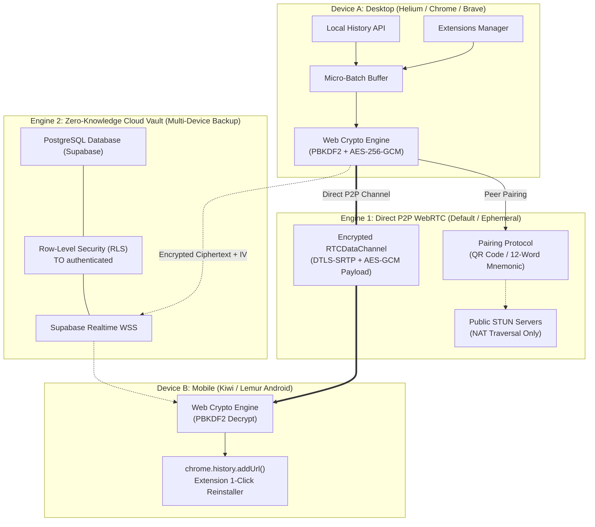

# Imhotep Browser Sync 🏛️⚡

<p align="center">
  
</p>

<p align="center">
  <strong>Zero-Knowledge Client-Side E2EE Synchronization Engine for Modern Browsers</strong><br>
  <em>Direct P2P WebRTC & Encrypted Cloud Vault for History and Extensions</em>
</p>

<p align="center">
  <a href="LICENSE"></a>
  
  
  
  
  
  
</p>

---

## 📖 Overview

**Imhotep Browser Sync** (by [Imhotep Tech](https://imhotep.tech)) is an open-source, client-side zero-knowledge synchronization suite engineered for users who demand true privacy. Named after **Imhotep**—the legendary ancient Egyptian polymath, architect of the Saqqara Step Pyramid, and patron of geometric precision—this extension gives you effortless synchronization of your browsing history and extension inventory without ever exposing your plaintext data to central servers or cloud monopolies.

### Why Imhotep?
* 🛡️ **Mathematical Zero-Knowledge**: Derived keys via **PBKDF2 (100,000 iterations)** + **AES-256-GCM** authenticated encryption directly in the browser sandbox.
* ⚡ **Dual Sync Engine**: Choose between **Direct P2P WebRTC** (serverless, ephemeral QR/12-word pairing) and **Cloud Vault** (Supabase multi-device background sync with Row-Level Security).
* 🧩 **Extension Manager & 1-Click Reinstall**: Synchronize your favorite extensions and reinstall them on fresh machines or mobile browsers with a single tap.
* 📱 **Mobile-First Android Support**: Full compatibility with Android Chromium environments (**Kiwi Browser**, **Lemur Browser**), alongside **Helium**, **Google Chrome**, **Brave**, and **Microsoft Edge**.
* 🪶 **Featherweight Antigravity UI**: Pure vanilla TypeScript + Tailwind CSS design with glassmorphic spatial cards (~60KB production bundle), avoiding heavy runtime frameworks.

---

## 🏛️ Architecture & Dual-Engine Model

Imhotep incorporates two distinct synchronization engines, enabling you to tailor your telemetry transport to your privacy requirements:



---

## ⚖️ Dual-Engine Feature Comparison

| Capability | Direct P2P WebRTC (Engine 1) | Supabase Cloud Vault (Engine 2) |
| :--- | :---: | :---: |
| **Default Mode** | :white_check_mark: Yes (Out of the Box) | Optional (User Opt-In) |
| **Account Required** | :x: **No** (Completely Anonymous) | Yes (Email + Password / Magic Link) |
| **Central Server Footprint** | :x: **None** (Ephemeral NAT STUN only) | Encrypted Ciphertext + IV Only |
| **Both Devices Must Be Online** | Yes (Direct connection required) | No (Asynchronous cloud buffering) |
| **Pairing Mechanism** | Dynamic QR Code or 12-Word Seed | Master Password + Supabase Auth |
| **Cross-Device Disaster Recovery** | Manual on-demand sync | Automated real-time background sync |
| **Data Retention** | Ephemeral (zero persistence) | Rolling 90-day auto-purge policy |
| **Bandwidth Limits** | Unlimited (Direct LAN / P2P speed) | Free Supabase tier limits |

---

## 🔐 Cryptographic Proof & Security Model

Imhotep adheres to a strict zero-knowledge security mandate. At no point in the lifecycle can Imhotep Tech, internet service providers, or cloud operators inspect your browsing data:

```
[Plaintext Event]
       │
       ▼
[Client Sandbox: PBKDF2 Key Derivation]
  ├── Password / Seed Phrase
  └── 16-Byte Cryptographic Salt (crypto.getRandomValues)
       │ (100,000 Iterations / SHA-256)
       ▼
[Client Sandbox: AES-256-GCM Encryption]
  ├── Derived 256-bit Key
  ├── Fresh 12-Byte IV per Batch
  └── 128-bit Authentication Tag
       │
       ▼
[Ciphertext Bundle: Base64(IV + Ciphertext + Tag)]
       │
       ├───► WebRTC RTCDataChannel (DTLS-SRTP Transport)
       └───► Supabase Cloud Storage (PostgreSQL Encrypted Column)
```

> [!NOTE]
> For complete cryptographic specifications, threat models, and vulnerability disclosure policies, consult our [SECURITY.md](SECURITY.md).

---

## 🚀 Installation & Browser Setup Guides

### 1. Build from Source

Ensure you have [Node.js (v18+)](https://nodejs.org/) installed:

```bash
# Clone the repository
git clone https://github.com/imhotep-tech/imhotep_browser_sync.git
cd imhotep_browser_sync

# Install dependencies
npm install

# Build production artifacts
npm run build
```

This compiles TypeScript, bundles styling with Tailwind CSS, and outputs the production extension into the `dist/` directory.

---

### 2. Loading into Desktop Browsers

#### Helium Browser & Google Chrome
1. Navigate to `chrome://extensions/` (or `helium://extensions/`).
2. Toggle **Developer mode** on in the upper-right corner.
3. Click **Load unpacked** and select the `dist/` directory in the repository.
4. Pin the **Imhotep Step Pyramid** icon to your toolbar.

#### Brave Browser
1. Open `brave://extensions/`.
2. Enable **Developer mode** toggle.
3. Select **Load unpacked** and point to the `dist/` folder.
4. If Brave Shields blocks local WebRTC loopbacks, ensure WebRTC IP handling is set to *Default*.

#### Microsoft Edge
1. Navigate to `edge://extensions/`.
2. Turn on **Developer mode** in the left sidebar menu.
3. Click **Load unpacked** and choose `dist/`.

---

### 3. Loading onto Android Mobile Devices

You can run full Chromium extensions on Android using **Kiwi Browser** or **Lemur Browser**:

#### Kiwi Browser (Android)
1. Install [Kiwi Browser](https://play.google.com/store/apps/details?id=com.kiwibrowser.browser) from Google Play or GitHub.
2. Transfer or package the `imhotep_browser_sync.zip` file (generated via `npm run package`) to your mobile device, or extract the `dist/` folder.
3. Tap the **Three Dots (⋮) Menu** -> **Extensions**.
4. Enable **Developer mode**.
5. Tap **+(from .zip/.crx/.user.js)** and select `imhotep_browser_sync.zip`, or select **Load unpacked**.
6. Imhotep Browser Sync is now active in Kiwi Browser!

#### Lemur Browser (Android)
1. Install [Lemur Browser](https://play.google.com/store/apps/details?id=com.lemurbrowser.exts) on Android.
2. Navigate to the Extension Management screen.
3. Enable **Developer mode** and load the unpacked build or zip archive.

---

## 📱 How to Pair & Sync Devices

```
┌─────────────────────────────────┐       ┌─────────────────────────────────┐
│     Desktop (Helium / Chrome)   │       │   Mobile (Kiwi / Lemur Android) │
│                                 │       │                                 │
│   [ Generate Ephemeral QR ]     │ ───►  │     [ Scan QR Camera View ]     │
│                OR               │       │                OR               │
│   12-Word Mnemonic Seed Phrase  │ ───►  │   Enter / Paste 12-Word Seed    │
└─────────────────────────────────┘       └─────────────────────────────────┘
                 │                                         │
                 └────────────── WebRTC DataChannel ───────┘
                              (Direct LAN / WAN)
```

1. Click the **Imhotep** extension icon to open the glassmorphic Antigravity popup.
2. Navigate to the **P2P Hub** tab.
3. On Device A, click **Show Pairing QR** or copy the **12-Word Seed**.
4. On Device B, scan the QR code or enter the 12 words and click **Connect**.
5. Once paired, your browsing history and extension inventory will stream automatically with real-time indicators!

---

## 🛡️ Sandbox Filter Safeguards

To protect your privacy and ensure clean sync states, the following traffic is automatically filtered out by the background service worker:
* 🔒 **Incognito & Private Tabs**: Never inspected, tracked, or synchronized.
* ⚙️ **Internal System Protocols**: `chrome://`, `helium://`, `brave://`, `edge://`, `about:`, `file://`.
* 💻 **Localhost & Intranet Addresses**: `http://localhost`, `http://127.0.0.1`, `http://[::1]`.
* 🧩 **Extension Sandboxes**: `chrome-extension://*`.

---

## 📂 Repository Layout

```
imhotep_browser_sync/
├── LICENSE                 # Apache 2.0 Open Source License
├── README.md               # Project documentation, guides, and architecture
├── SECURITY.md             # Cryptographic proofs & vulnerability disclosure policy
├── PRIVACY.md              # Zero-knowledge privacy charter & data autonomy
├── CONTRIBUTING.md         # Open-source developer guide & conventions
├── docs/
│   └── STORE_LISTING.md    # Chrome Web Store metadata & submission guidelines
├── public/
│   └── icons/              # Cyber-Egyptian telemetry brand vector & raster assets
│       ├── icon.svg        # Scalable Vector Graphics master logo (512x512)
│       ├── icon-16.png     # 16x16 Favicon & extension bar asset
│       ├── icon-48.png     # 48x48 Extension manager asset
│       └── icon-128.png    # 128x128 Chrome Web Store & HiDPI asset
├── supabase/
│   └── schema.sql          # Zero-knowledge PostgreSQL schema with RLS policies
└── src/
    ├── crypto/             # Web Crypto PBKDF2 & AES-256-GCM algorithms
    ├── p2p/                # WebRTC DataChannel & QR/mnemonic pairing protocols
    ├── cloud/              # Supabase Realtime & PostgreSQL vault client
    ├── background/         # MV3 Chrome background service worker
    ├── popup/              # Glassmorphic Antigravity UI & Extension Gallery
    └── types/              # Strict TypeScript definitions
```

---

## 📜 Governance & License

* **Open-Source License**: Licensed under the [Apache License, Version 2.0](LICENSE).
* **Security & Vulnerability Disclosure**: See [SECURITY.md](SECURITY.md).
* **Privacy Charter**: See [PRIVACY.md](PRIVACY.md).
* **Developer Guidelines**: See [CONTRIBUTING.md](CONTRIBUTING.md).

---

<p align="center">
  Built with 🏛️ geometric precision by <strong>Imhotep Tech</strong>.
</p>
