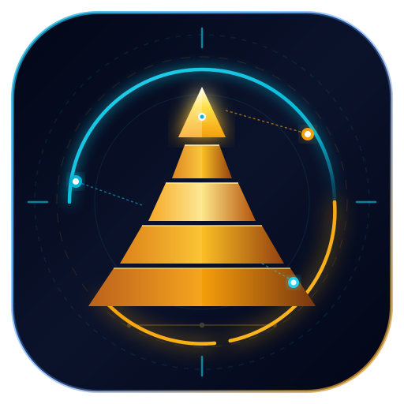

# Imhotep Browser Sync 🏛️⚡

<p align="center">
  
</p>

<p align="center">
  <strong>100% Peer-to-Peer, Zero-Server Synchronization Engine for Modern Browsers</strong><br>
  <em>Direct Device-to-Device WebRTC DataChannels for Browsing History and Extensions</em>
</p>

<p align="center">
  <a href="LICENSE"></a>
  
  
  
  
  
</p>

---

## 📖 Overview

**Imhotep Browser Sync** (by [Imhotep Tech](https://imhotep.tech)) is an open-source, **100% Peer-to-Peer (P2P)** synchronization suite engineered for users who demand absolute digital sovereignty. Named after **Imhotep**—the legendary ancient Egyptian architect of the Saqqara Step Pyramid and master of geometric precision—this extension synchronizes your browsing history and extension inventory directly device-to-device without a single byte ever touching a central cloud server or third-party database.

### Why Imhotep?
* 🌐 **100% Serverless & Decentralized**: Direct device-to-device streaming over encrypted **WebRTC DataChannels (DTLS-SRTP)**. Zero accounts, zero logins, zero cloud storage.
* ⚡ **Instant Pairing**: Pair any two devices in seconds using an ephemeral **QR Code** or a human-readable **12-Word BIP-39 Mnemonic Phrase**.
* 🧩 **Extension Manager & 1-Click Reinstall**: Synchronize your extension inventory across devices and reinstall extensions on fresh machines or mobile browsers with a single tap.
* 📱 **Mobile-First Android Support**: Full native compatibility with Android Chromium environments (**Kiwi Browser**, **Lemur Browser**), alongside **Helium Browser**, **Google Chrome**, **Brave**, and **Microsoft Edge**.
* 🛡️ **Zero-Leakage Privacy Filters**: Automatically filters out Incognito sessions, system schemes (`chrome://`), and localhost development ports.
* 🪶 **Featherweight Antigravity UI**: Pure vanilla TypeScript + Tailwind CSS glassmorphic spatial UI (~60KB production bundle) with instant popup launch and dark/light mode.

---

## 🏛️ Architecture: 100% Direct P2P Mesh

Imhotep operates entirely on a decentralized peer-to-peer transport topology. Your data never touches any intermediate application server:

```mermaid
flowchart LR
    subgraph DeviceA ["Device A: Desktop (Helium / Chrome / Brave)"]
        A_Hist["Local History API<br/>(chrome.history)"]
        A_Ext["Extension Manager<br/>(chrome.management)"]
        A_Buffer["Micro-Batch Buffer<br/>(Debounced)"]
        A_P2P["WebRTC P2P Engine<br/>(RTCDataChannel)"]
        
        A_Hist & A_Ext --> A_Buffer --> A_P2P
    end

    subgraph Pairing ["Pairing & NAT Traversal"]
        STUN["Public STUN Servers<br/>(stun.l.google.com:19302)<br/>*ICE Discovery Only*"]
        Signal["Ephemeral QR Code /<br/>12-Word Mnemonic Ticket"]
    end

    subgraph DeviceB ["Device B: Mobile (Kiwi / Lemur Android)"]
        B_P2P["WebRTC P2P Engine<br/>(RTCDataChannel)"]
        B_Ingest["chrome.history.addUrl()<br/>Extension 1-Click Reinstall"]
        
        B_P2P --> B_Ingest
    end

    A_P2P -.->|ICE Candidates| STUN
    B_P2P -.->|ICE Candidates| STUN
    A_P2P <===>|Ephemeral Signal Exchange| Signal <===> B_P2P
    A_P2P <==== Direct Encrypted WebRTC DataChannel (DTLS-SRTP) ====> B_P2P
```

### Key Architectural Guarantees:
1. **Zero External Servers**: No authentication servers, no backend database, no telemetry collectors.
2. **Encrypted Wire**: All WebRTC DataChannels are natively secured via DTLS (Datagram Transport Layer Security) with peer-verified certificates.
3. **No Host Permissions Required**: Imhotep requires **zero host permissions** (`host_permissions: []`), ensuring maximum security and smooth Chrome Web Store review.

---

## 📱 How to Pair & Sync Devices

```
┌─────────────────────────────────┐       ┌─────────────────────────────────┐
│     Desktop (Helium / Chrome)   │       │   Mobile (Kiwi / Lemur Android) │
│                                 │       │                                 │
│   [ Generate Ephemeral QR ]     │ ───►  │     [ Scan QR Camera View ]     │
│                OR               │       │                OR               │
│   12-Word Mnemonic Seed Phrase  │ ───►  │   Enter / Paste 12-Word Seed    │
└─────────────────────────────────┘       └─────────────────────────────────┘
                 │                                         │
                 └────────────── WebRTC DataChannel ───────┘
                              (Direct LAN / WAN)
```

1. Click the **Imhotep** extension icon to open the glassmorphic Antigravity popup.
2. Navigate to the **P2P Hub** tab.
3. On **Device A**, view the ephemeral **Pairing QR Code** or copy the **12-Word Pairing Phrase**.
4. On **Device B**, select **Connect to Peer**, paste the mnemonic or scan the QR code, and click **Pair Devices**.
5. Once paired, your browsing history micro-batches and installed extensions stream in real-time directly between devices!

---

## 🚀 Installation & Setup Guides

### 1. Build from Source

Ensure you have [Node.js (v18+)](https://nodejs.org/) installed:

```bash
# Clone the repository
git clone https://github.com/imhotep-tech/imhotep_browser_sync.git
cd imhotep_browser_sync

# Install dependencies
npm install

# Build production artifacts
npm run build

# Or generate a distribution ZIP for Chrome Web Store / Android
npm run package
```

The compiled extension is output to `dist/`, and a production zip archive (`imhotep-browser-sync.zip`, ~60KB) is generated.

---

### 2. Loading into Desktop Browsers

#### Helium Browser & Google Chrome
1. Navigate to `chrome://extensions/` (or `helium://extensions/`).
2. Toggle **Developer mode** on in the upper-right corner.
3. Click **Load unpacked** and select the `dist/` directory.
4. Pin the **Imhotep Step Pyramid** icon to your toolbar.

#### Brave Browser
1. Open `brave://extensions/`.
2. Enable **Developer mode**.
3. Click **Load unpacked** and select `dist/`.
4. Ensure Brave Shields allows WebRTC IP handling (set to *Default*).

#### Microsoft Edge
1. Navigate to `edge://extensions/`.
2. Enable **Developer mode** in the sidebar.
3. Click **Load unpacked** and select `dist/`.

---

### 3. Loading onto Android Mobile Devices

You can run full Chromium extensions on Android using **Kiwi Browser** or **Lemur Browser**:

#### Kiwi Browser (Android)
1. Install [Kiwi Browser](https://play.google.com/store/apps/details?id=com.kiwibrowser.browser) from Google Play or GitHub.
2. Transfer `imhotep-browser-sync.zip` to your mobile device (or extract `dist/`).
3. Tap the **Three Dots (⋮) Menu** -> **Extensions**.
4. Enable **Developer mode**.
5. Tap **+(from .zip/.crx/.user.js)** and select `imhotep-browser-sync.zip` (or **Load unpacked**).
6. Imhotep Browser Sync is now active in Kiwi Browser!

#### Lemur Browser (Android)
1. Install [Lemur Browser](https://play.google.com/store/apps/details?id=com.lemurbrowser.exts) on Android.
2. Navigate to the Extension Management screen.
3. Enable **Developer mode** and load the unpacked build or zip archive.

---

## 🛡️ Sandbox Filter Safeguards

To protect your privacy and guarantee clean sync states, the background service worker automatically excludes:
* 🔒 **Incognito & Private Tabs**: Never tracked, inspected, or synchronized.
* ⚙️ **Internal System Schemes**: `chrome://`, `helium://`, `brave://`, `edge://`, `about:`, `file://`.
* 💻 **Localhost & Intranet Addresses**: `http://localhost`, `http://127.0.0.1`, `http://[::1]`.
* 🧩 **Extension Sandboxes**: `chrome-extension://*`.

---

## 📂 Repository Layout

```
imhotep_browser_sync/
├── LICENSE                 # Apache 2.0 Open Source License
├── README.md               # Project documentation, guides, and architecture
├── AGENTS.md               # AI Agent operating manual & feature extension playbooks
├── SECURITY.md             # Security policy & WebRTC cryptographic specs
├── PRIVACY.md              # Zero-server privacy charter & data autonomy
├── CONTRIBUTING.md         # Open-source developer guide & conventions
├── docs/
│   └── STORE_LISTING.md    # Chrome Web Store metadata & submission copy
├── public/
│   └── icons/              # Cyber-Egyptian telemetry brand vector & raster assets
│       ├── icon.svg        # Scalable Vector Graphics master logo (512x512)
│       ├── icon-16.png     # 16x16 Extension bar asset
│       ├── icon-48.png     # 48x48 Extension manager asset
│       └── icon-128.png    # 128x128 Chrome Web Store asset
└── src/
    ├── crypto/             # Web Crypto PBKDF2 & AES-256-GCM algorithms
    ├── p2p/                # WebRTC DataChannel & QR/mnemonic pairing protocols
    ├── background/         # MV3 Chrome background service worker
    ├── popup/              # Glassmorphic Antigravity UI & Extension Gallery
    └── types/              # Strict TypeScript definitions
```

---

## 📜 Governance & License

* **Open-Source License**: Licensed under the [Apache License, Version 2.0](LICENSE).
* **Security Policy**: See [SECURITY.md](SECURITY.md).
* **Privacy Charter**: See [PRIVACY.md](PRIVACY.md).
* **Developer Guidelines**: See [CONTRIBUTING.md](CONTRIBUTING.md).
* **AI Agent Instructions**: See [AGENTS.md](AGENTS.md).

---

<p align="center">
  Built with 🏛️ geometric precision by <strong>Imhotep Tech</strong>.
</p>
