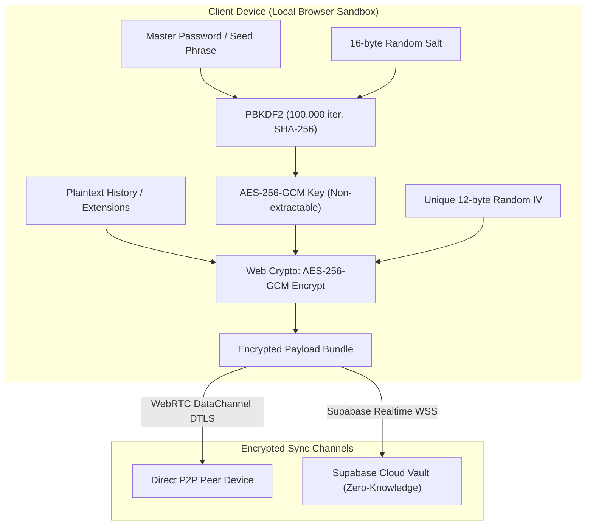

# Security Policy & Cryptographic Architecture

Imhotep Browser Sync is engineered from the ground up with a strict **Zero-Knowledge, Client-Side End-to-End Encryption (E2EE)** security model. Your personal web telemetry—including browsed history, page titles, visit frequencies, and extension configurations—is encrypted directly on your local device before touching any peer connection or cloud storage backend.

---

## 1. Cryptographic Architecture

### Key Derivation: PBKDF2-HMAC-SHA256
All symmetric encryption keys are derived on the client using the W3C Web Cryptography API (`crypto.subtle`):

* **Algorithm**: PBKDF2 (`PBKDF2-HMAC-SHA256`)
* **Iterations**: `100,000` minimum rounds (resistant to GPU/ASIC rainbow attacks)
* **Salt**: 16 cryptographically secure random bytes generated via `crypto.getRandomValues(new Uint8Array(16))` per user profile
* **Derived Key**: 256-bit symmetric raw key imported into `AES-GCM` with `encrypt` and `decrypt` key usages, marked non-extractable

### Data Encryption: AES-256-GCM
All payloads synchronized across devices are protected with authenticated symmetric encryption:

* **Cipher**: Advanced Encryption Standard in Galois/Counter Mode (`AES-256-GCM`)
* **Key Length**: 256 bits
* **Initialization Vector (IV)**: 12-byte (96-bit) cryptographically secure random nonce generated fresh for **every single batch/payload**
* **Authentication Tag**: 128-bit integrity tag appended to the ciphertext to ensure tamper-evidence and replay detection
* **Format**: Standard Base64 encoded bundle: `[IV (12 bytes) || Ciphertext || Auth Tag (16 bytes)]`

---

## 2. Threat Model & Security Boundaries

### Protected Assets
1. **Browsing History**: URLs, titles, visit timestamps, and transition qualifiers.
2. **Extension Catalog**: Extension IDs, enabled states, display names, and installation parameters.
3. **Device Identifiers**: Device nicknames, cryptographic public pairing tokens.

### Security Guarantees
* **Zero-Knowledge Server State**: The Supabase Database Vault receives and stores only ciphertext and random IVs. It has zero access to user passwords, salt derivation keys, or unencrypted data. A full compromise of the database server reveals zero plaintext browsing logs.
* **Direct P2P Channel**: In WebRTC mode, connections communicate peer-to-peer over DTLS-SRTP encrypted RTCDataChannels, bypassing external servers entirely except for standard STUN NAT traversal.
* **Memory Isolation**: Derived keys are kept strictly in transient memory in the Chrome MV3 background service worker and are cleared when the browser session terminates or when the user locks their vault.
* **Exclusion Sandbox**: System URLs (`chrome://`, `edge://`, `about:`, `file://`), extension pages (`chrome-extension://`), local development addresses (`localhost`, `127.0.0.1`), and Incognito/Private browsing tabs are permanently blocked from capture at the service worker hook level.

---

## 3. Supported Versions

| Version | Supported | Security Maintenance |
| :--- | :---: | :--- |
| `1.0.x` (MV3) | :white_check_mark: | Active vulnerability monitoring & patches |
| `< 1.0.0` | :x: | Deprecated |

---

## 4. Reporting a Vulnerability

We deeply appreciate the efforts of the global security research community in identifying vulnerabilities responsibly.

If you believe you have discovered a vulnerability in Imhotep Browser Sync:

1. **Email Us**: Send an encrypted or plain report to `security@imhotep.tech`.
2. **Do Not Open Public Issues**: Please refrain from opening public GitHub issues, discussions, or social media posts until we have coordinated a fix.
3. **Include Reproduction Steps**:
   - Manifest/browser version (e.g., Helium 1.2, Chrome 124, Kiwi Android).
   - Step-by-step reproduction instructions or proof-of-concept (PoC).
   - Potential impact evaluation.

### Response SLA & Safe Harbor
* **Acknowledgement**: Within 24 hours of report receipt.
* **Triage & Assessment**: Within 48 hours.
* **Remediation & Patch Deployment**: Critical flaws patched within 72 hours and released via emergency extension updates.
* **Safe Harbor**: Imhotep Tech will not pursue legal action against security researchers who conduct testing in good faith, avoid privacy violations, do not destroy data, and adhere to responsible disclosure timelines.
